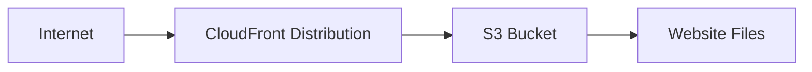

# Day 14: Static Website Hosting (Mini Project 1)


## 🎯 Project Overview

This mini project demonstrates how to deploy a static website on AWS using Terraform. We create a complete static website hosting solution using Amazon CloudFront for content delivery and a secure S3-backed origin for the website files.

## 🏗️ Architecture



> The CloudFront distribution acts as the global entry point, while the S3 bucket stores the static files and serves as the origin for the website.

### Components

- S3 bucket: stores the static website files
- CloudFront distribution: delivers the content globally with HTTPS
- Origin access control: restricts direct public access to the source bucket
- Terraform: provisions and manages the AWS resources

## 📁 Project Structure

```text
day14/
├── main.tf
├── variables.tf
├── outputs.tf
├── provider.tf
├── backend.tf
├── README.md
├── .github/
│   └── workflows/
│       └── deploy.yml
└── www/
    ├── index.html
    ├── style.css
    └── script.js
```

## 🚀 Features

### Website Features

- Responsive design for desktop and mobile
- Dark/light theme toggle
- Interactive UI elements and status updates
- Clean AWS-themed presentation
- Smooth animations and modern styling

### Infrastructure Features

- S3-backed static hosting
- CloudFront distribution for global speed and HTTPS
- Proper MIME type handling for static files
- Terraform-managed infrastructure as code
- CI/CD deployment automation with GitHub Actions

## 🛠️ Prerequisites

1. AWS CLI configured with valid credentials
2. Terraform installed (version 1.0+ recommended)
3. An AWS account with permissions for:
   - S3
   - CloudFront
   - IAM / access control configuration

## 📋 Deployment Steps

### 1. Initialize Terraform

```bash
cd practice_14
terraform init
```

### 2. Review the Plan

```bash
terraform plan
```

### 3. Deploy Infrastructure

```bash
terraform apply
```

Type `yes` when prompted to confirm.

### 4. Access Your Website

After deployment, Terraform will print the CloudFront URL.

```bash
terraform output
```

Example output:

```text
website_url = "https://d123abc456.cloudfront.net"
```

## 📊 Resources Created

| Resource Type | Purpose | Count |
| --- | --- | --- |
| S3 Bucket | Stores website files | 1 |
| S3 Bucket Policy | Allows CloudFront to access objects | 1 |
| S3 Objects | Website assets (HTML, CSS, JS) | Multiple |
| CloudFront Distribution | Global CDN delivery | 1 |
| Origin Access Control | Secure access configuration | 1 |

## 🔧 Configuration Details

### S3 Configuration

- Bucket name is generated using the configured prefix
- Website files are uploaded with the correct MIME types
- Access is restricted through CloudFront access control
- Files are synced from the local `www` folder

### CloudFront Configuration

- Origin points to the S3 bucket
- HTTPS is enforced
- Default root object is `index.html`
- Caching is enabled for web assets
- Distribution is created in the standard global pricing class

## 🚀 GitHub Actions Deployment

This project includes a CI/CD workflow at [.github/workflows/deploy.yml](.github/workflows/deploy.yml).

### Trigger Conditions

The pipeline runs when:

- code is pushed to the `main` branch
- Terraform or website files are updated
- the workflow is started manually

### Required GitHub Secrets

Add these in GitHub repository settings:

- `AWS_ACCESS_KEY_ID`
- `AWS_SECRET_ACCESS_KEY`
- `AWS_REGION` (optional, defaults to `us-east-1`)

### What the workflow does

- checks out the repository
- installs Terraform
- configures AWS credentials
- runs `terraform init`
- runs `terraform validate`
- runs `terraform apply`
- uploads the static files to S3
- invalidates the CloudFront cache

## 🧹 Cleanup

To remove all resources created by this project:

```bash
terraform destroy
```

Type `yes` when prompted.

## 📚 Learning Objectives

After completing this project, you should understand:

- how to provision AWS resources with Terraform
- how static websites are hosted on AWS
- how CloudFront improves delivery and performance
- how to upload website files and configure access
- how to automate deployments with GitHub Actions
- how infrastructure can be managed as code

## 🔗 Useful Links

- [AWS S3 Documentation](https://docs.aws.amazon.com/amazon-s3/)
- [CloudFront Documentation](https://docs.aws.amazon.com/cloudfront/)
- [Terraform AWS Provider](https://registry.terraform.io/providers/hashicorp/aws/latest/docs)

## 🎉 Next Steps

Consider extending this project with:

- multiple environments such as dev and prod
- custom error pages and cache policies
- additional security headers
- advanced CI/CD improvements
- Terraform remote state and locking for production use
